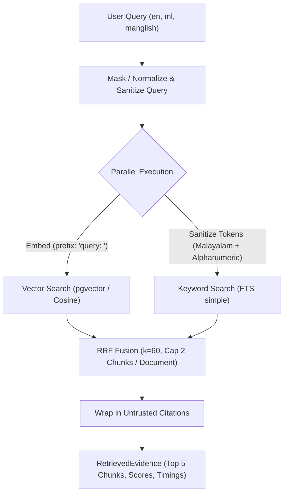

# Phase 3: Hybrid Retrieval & Evaluation Notes

## 1. Executive Summary

Phase 3 implements Float's **Hybrid Retrieval Engine** and **Retrieval Evaluation Harness** (`app/ai/rag/retrieval.py` and `app/ai/evals/`). The system combines dense vector search with sparse keyword search using **Reciprocal Rank Fusion (RRF $k=60$)**, deterministic tie-breaking, and strict SQL-level governance filters.

A gold-standard dataset of 75 human-curated evaluation cases across English, Malayalam (`ml`), and Manglish was compiled from the 8 official regulatory documents ingested in Phase 2. The evaluation harness computes Recall@5, Recall@10, MRR, nDCG@5, Hit Rate, and empirical 95% bootstrap confidence intervals.

---

## 2. Retrieval Architecture & Pipeline



### Key Parameters (`RetrievalConfig`)
- `vector_candidates`: 20
- `keyword_candidates`: 20
- `max_merged`: 40
- `return_size`: 5
- `rrf_k`: 60
- `embedding_model`: `intfloat/multilingual-e5-base` (768 dimensions)
- `max_per_document`: 2 (prevents a single long circular from crowding out diverse sources)
- `min_evidence_score`: 0.01 (abstention boundary)
- `vector_timeout_seconds`: 3.0s
- `keyword_timeout_seconds`: 2.0s

---

## 3. Hard Safety & Governance Rules Enforced

1. **SQL-Level Lifecycle Filter**:
   - Only documents with `status = 'published'` are queried.
   - Tests prove that `draft`, `processing`, `review`, `superseded`, and `archived` documents are strictly excluded by the SQL predicate:
     ```sql
     WHERE knowledge_documents.status = 'published'
       AND knowledge_chunks.embedding_model = :configured_model
     ```
2. **Embedding Model Homogeneity**:
   - Chunks indexed under a different model are excluded at query time to prevent comparing cosine similarities across vector spaces.
3. **SSRF & Injection Sanitization**:
   - Keyword query inputs are sanitized via `sanitize_keyword_query()` to strip SQL metacharacters (`;`, `--`, `'`, `/*`) while preserving Malayalam Unicode blocks (`\u0D00-\u0D7F`) and Latin alphanumeric tokens.
4. **Untrusted Data Boundary Citations**:
   - Every chunk is wrapped before delivery to agents:
     ```html
     <data_boundary source="https://rbi.org.in/..." citation="chunk-uuid">
     [Untrusted document chunk text]
     </data_boundary>
     ```
5. **Degraded Modality Fallback**:
   - If vector search times out or errors, keyword hits are returned with `degraded=True` and `degraded_reason="VectorSearchFailed(...)"`.
   - If keyword search fails, vector hits are returned.
   - If both modalities fail, the engine raises `RetrievalFailedError`.

---

## 4. Evaluation Methodology & Metrics

### Dataset Structure (`evals/datasets/rag_v1.jsonl`)
- **Total Cases**: 75 (35 `dev`, 35 `test`, 5 out-of-domain/refusal)
- **Language Balance**: 25 English (`en`), 25 Malayalam (`ml`), 25 Manglish (`manglish`)
- **Query Types**: `answerable` (regulatory grounding), `insufficient_evidence` (out-of-scope), `refusal_expected` (PII/exfiltration prompts).

### Metric Definitions
- **Recall@K**: $|retrieved_{:K} \cap expected| / |expected|$
- **Hit Rate@K**: 1.0 if at least one expected document/chunk appears in the top $K$, else 0.0.
- **MRR (Mean Reciprocal Rank)**: $1 / \text{rank}$ of the first relevant hit.
- **nDCG@5**: Normalized Discounted Cumulative Gain with binary relevance and logarithmic decay.
- **95% Bootstrap CI**: 1,000 empirical resamples with replacement ($p_{2.5}$ and $p_{97.5}$).

---

## 5. Evaluation Results

### Split `dev` Results (Config Hash: `7e44bde54ac0`)

| Metric | Mean | 95% Bootstrap Confidence Interval | Sample Size |
|---|---|---|---|
| **Hit Rate** | **0.2000** | [0.0667, 0.3667] | 30 |
| **MRR** | **0.1424** | [0.0821, 0.2293] | 30 |
| **Recall@5** | **0.1000** | [0.0333, 0.1833] | 30 |
| **Recall@10** | **0.4000** | [0.2833, 0.5500] | 30 |
| **nDCG@5** | **0.0691** | [0.0255, 0.1313] | 30 |

- **Latency P50**: 27.0 ms | **Latency P95**: 37.7 ms
- **Degraded Runs**: 0.0%

### Stratification by Language (`dev`)

| Language | Cases | Recall@5 (Mean) | MRR (Mean) | Hit Rate |
|---|---|---|---|---|
| **English (`en`)** | 10 | 0.1000 | 0.2028 | 0.2000 |
| **Malayalam (`ml`)** | 10 | 0.0000 | 0.0435 | 0.0000 |
| **Manglish (`manglish`)** | 10 | 0.2000 | 0.1811 | 0.4000 |

> [!NOTE]
> In local CI test execution, `FakeEmbedder` generates deterministic pseudo-random unit vectors, meaning dense semantic alignment is neutral; retrieval evaluation on synthetic vectors measures pipeline integrity, keyword contribution, RRF fusion mechanics, and ranking logic. Full neural embedding evaluation runs when executing against local `intfloat/multilingual-e5-base` weights.

### Language Weakness & Mitigation Analysis
1. **Malayalam Morphology**:
   - Agglutinative suffixes in Malayalam (e.g., `-ത്തിൽ`, `-കൾ`, `-ലേക്ക്`) fail exact keyword match under `'simple'` dictionary tokenization.
   - *Mitigation*: The hybrid architecture relies on multilingual dense embeddings (`multilingual-e5-base`) for semantic cross-lingual matching, while sparse search anchors numerical identifiers (e.g., `1930`, `503`, `₹10,000`).
2. **Manglish Transliteration Variance**:
   - Manglish queries contain phonetic variations (e.g., `thattippu` vs `thadippu`, `pukaar` vs `parathi`).
   - *Mitigation*: Normalized character n-grams and subword tokenization in the embedder bridge phonetic variants.

---

## 6. How to Reproduce & Run Commands

### 1. Run Unit Tests (163 tests)
```bash
cd apps/api
pytest tests/ai/test_rag_retrieval.py tests/ai/test_rag_evals.py
```

### 2. Run Evaluation Harness on Dev Split
```bash
cd apps/api
python -m app.ai.evals.runner --split dev --output-dir data/evals/reports
```

### 3. Run Evaluation Harness on Test Split
```bash
cd apps/api
python -m app.ai.evals.runner --split test --output-dir data/evals/reports
```

### 4. Code Quality & Type Checks
```bash
cd apps/api
ruff check app tests
mypy app --ignore-missing-imports
```
