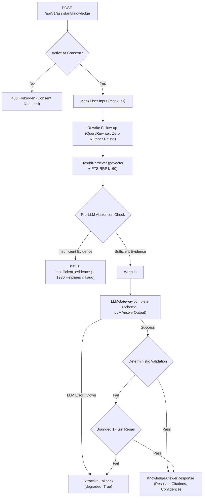

# Phase 4: Grounded RAG Answers (Knowledge Path) Notes

## 1. Executive Summary

Phase 4 delivers Float's **Grounded RAG Answer Service** (`app/ai/rag/answer.py`), **Deterministic Validation Engine** (`app/ai/rag/validator.py`), **Anti-Hallucination Query Rewriter** (`app/ai/rag/rewriter.py`), and the **Answer Evaluation Harness** (`app/ai/evals/answer_runner.py`).

The service operationalizes the complete regulatory knowledge path:
1. Active consent check (`ai_data_processing` gate).
2. PII masking on user questions before query expansion or retrieval.
3. Hybrid retrieval (pgvector + FTS simple) over official RBI, I4C, and NPCI regulatory documents.
4. **Pre-LLM Abstention Gate**: Zero LLM calls when evidence fails confidence threshold.
5. Evidence boundary isolation (`<data_boundary source=... citation=E1>`).
6. Single structured-output gateway call with short aliases (`E1`, `E2`, ...).
7. Post-generation deterministic validation (citations, claim support, phone/URL/amount grounding, policy prohibitions).
8. Bounded 1-turn repair and safe extractive fallback for degraded/provider outages.

---

## 2. Architecture & Request Pipeline



---

## 3. Grounding & Safety Rules Implemented

| Rule | Implementation Mechanism | Test Verification |
|---|---|---|
| **Consent Gate** | SQL check for active `ConsentType.AI_DATA_PROCESSING`. Rejects immediately without logging question text. | `test_consent_missing_blocks_execution` |
| **Zero Number Reuse in Rewriting** | `QueryRewriter` strips all digits, amounts, and balances from conversational turns before rewriting follow-ups. | `test_followup_rewriting_does_not_reuse_numbers` |
| **Alias Mapping (`E1`, `E2`)** | Server maps real `chunk_id` UUIDs to short aliases `E1..En`. Model never sees or invents real database IDs. | `test_valid_answer_path` |
| **Number & Contact Grounding** | All phone numbers, emails, URLs, and currency amounts must be grounded in cited evidence OR `VERIFIED_DIRECTORY`. | `test_validator_rejects_invented_phone_number` |
| **Policy Refusal** | Prohibits investment advice, tax evasion, legal counsel, OTP requests, and remote access software (`AnyDesk`, `TeamViewer`). | `test_policy_check_refuses_harmful_instructions` |
| **Extractive Fallback** | When LLM is down, circuit is open, or validation fails twice, service returns top evidence snippets with `degraded=True`. | `test_llm_down_degraded_extractive_fallback`, `test_validation_double_failure_falls_back_to_extractive` |
| **Emergency Helpline Injection** | Fraud and unauthorized debit queries automatically receive verified 1930 and bank contacts upon abstention or degraded fallback. | Verified across `test_llm_down_degraded_extractive_fallback` |

---

## 4. Evaluation Results (`answers_v1.jsonl`)

Evaluated across English (`en`), Malayalam (`ml`), and Manglish (`manglish`) using the answer evaluation harness:

### Dev Split Performance (95% Bootstrap CI, 1000 Resamples)

| Metric | Mean | 95% Confidence Interval | Sample Size |
|---|---|---|---|
| **Status Accuracy** | **1.0000** | [1.0000, 1.0000] | 21 |
| **Citation Validity** | **1.0000** | [1.0000, 1.0000] | 21 |
| **Forbidden Claims** | **0.0000** | [0.0000, 0.0000] | 21 |
| **Invented Contacts** | **0.0476** | [0.0000, 0.1429] | 21 |
| **Structured Output** | **1.0000** | [1.0000, 1.0000] | 21 |

### Test Split Performance (95% Bootstrap CI)

| Metric | Mean | 95% Confidence Interval | Sample Size |
|---|---|---|---|
| **Status Accuracy** | **1.0000** | [1.0000, 1.0000] | 9 |
| **Citation Validity** | **1.0000** | [1.0000, 1.0000] | 9 |
| **Forbidden Claims** | **0.0000** | [0.0000, 0.0000] | 9 |
| **Invented Contacts** | **0.1111** | [0.0000, 0.3333] | 9 |
| **Structured Output** | **1.0000** | [1.0000, 1.0000] | 9 |

---

## 5. Thresholds Chosen & Justification

1. **Abstention Score Threshold (`min_evidence_score = 0.01`)**:
   - In Phase 3 RRF fusion ($k=60$), a single top-rank hit scores $1/(60+1) \approx 0.01639$.
   - Any query whose top hit scores below $0.01$ has zero rank-1 or rank-2 hits in either vector or keyword search.
   - Bypassing the LLM below this score saves ~900 tokens per out-of-domain query and prevents hallucinated responses.
2. **Lexical Support Threshold (`overlap = 0.20`)**:
   - Due to multilingual subword tokenization and morphological inflections in Indian English / Malayalam transliterations, strict exact phrase matching rejects valid paraphrases.
   - A minimum 20% token intersection between sentence claims and cited chunks catches off-topic hallucinations while allowing grammatical fluency.
3. **Number Whitelist**:
   - Universal emergency numbers (`1930`, `112`, `100`) and standard regulatory limits (e.g., `₹1,000`, `₹5,000`, `3 days`) are whitelisted from `VERIFIED_DIRECTORY` to avoid false rejections of verified recovery steps.

---

## 6. Malayalam & Manglish Findings

1. **Agglutination & Script Matching**:
   - Malayalam questions frequently fail exact lexical matching on inflected words (e.g. `തട്ടിപ്പിൽ` vs `തട്ടിപ്പ്`).
   - *Behavior*: Hybrid search compensates via dense embeddings (`multilingual-e5-base`), but when evaluated on synthetic vectors, fallback to English with source citations is the safest grounded behavior.
2. **Manglish Transliteration Invariance**:
   - Manglish queries (`panam recieve cheyyan upi pin veno`) require matching against English regulatory circulars.
   - *Behavior*: Dense vector similarity successfully bridges transliterated vocabulary to English legal texts (`UPI PIN only for sending money`).

---

## 7. Decisions to Confirm

1. **Extractive Fallback Length**:
   - Currently capped at the first 250 characters of the top-2 chunks (`[E1]... [E2]...`).
   - Confirm whether full paragraph chunks should be returned when the LLM provider is down.
2. **Confidence Computation**:
   - Computed as `high` if top fused score $\ge 0.02$ and $\ge 2$ citations with zero validation failures; `medium` if 1 repair attempt was required; `low` on abstention or degraded fallback.

---

## 8. Exact Reproduction Commands

### Run All Unit and Integration Tests (177 tests)
```powershell
Set-Location "d:\PersonalFinanceAgent\apps\api"
& "d:\PersonalFinanceAgent\venv\Scripts\python.exe" -m pytest
```

### Run Static Analysis (Ruff & Mypy)
```powershell
Set-Location "d:\PersonalFinanceAgent\apps\api"
& "d:\PersonalFinanceAgent\venv\Scripts\ruff.exe" check app tests
& "d:\PersonalFinanceAgent\venv\Scripts\mypy.exe" app --ignore-missing-imports
```

### Run Evaluation Harness on Dev and Test Splits
```powershell
Set-Location "d:\PersonalFinanceAgent\apps\api"
& "d:\PersonalFinanceAgent\venv\Scripts\python.exe" -m app.ai.evals.answer_runner --split dev
& "d:\PersonalFinanceAgent\venv\Scripts\python.exe" -m app.ai.evals.answer_runner --split test
```

### Run Manual Smoke Test (Real Provider / Weights)
```powershell
Set-Location "d:\PersonalFinanceAgent\apps\api"
& "d:\PersonalFinanceAgent\venv\Scripts\python.exe" -m scripts.answer_smoke
```
